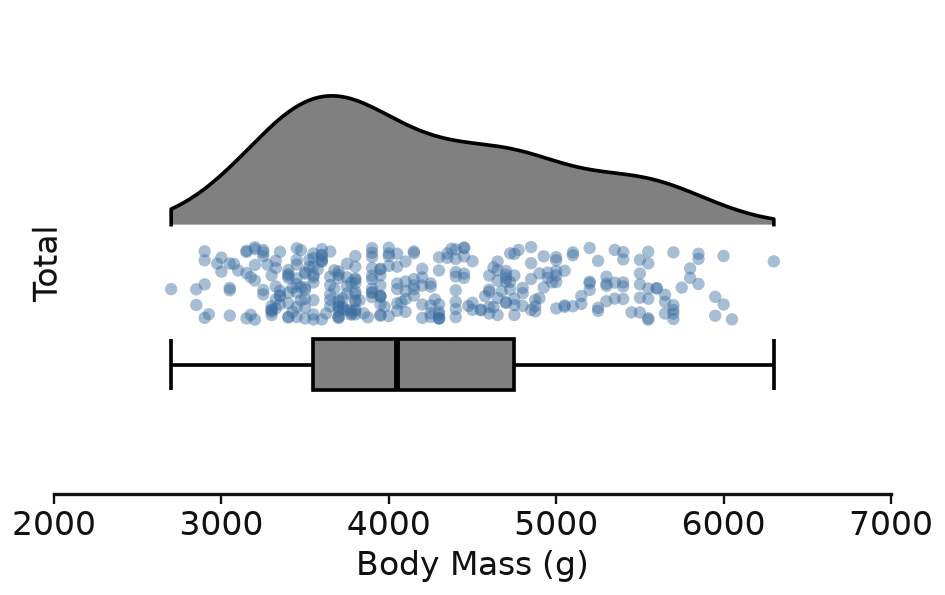

# raincloudkit

Raincloud plots — a half-violin **cloud**, a summary **box**, and jittered **rain** —
for any dataset, with every visual choice exposed as a plain dataclass field.



```python
import seaborn as sns
from raincloudkit import RainStyle, plot_raincloud

penguins = sns.load_dataset("penguins").dropna(subset=["body_mass_g"])

plot_raincloud(
    penguins, "body_mass_g",
    style=RainStyle(show_total=True, value_label="Body Mass (g)", point_alpha=0.45),
).savefig("raincloud.png")
```

## Install

```bash
pip install -e raincloud_plot
```

## Input

`plot_raincloud(data, value=None, group=None, style=RainStyle(), box=BoxSpec(), *, point_hue=None, ax=None)`

`data` may be any of:

| shape | call |
| --- | --- |
| tidy DataFrame | `plot_raincloud(df, "mass", "species")` |
| DataFrame, one numeric column | `plot_raincloud(df)` |
| mapping of label → values | `plot_raincloud({"a": xs, "b": ys})` |
| a bare sequence or Series | `plot_raincloud(values)` |

It returns a `RaincloudResult` with `.figure`, `.ax`, `.groups`, `.colorbar`, a
`.stats` frame (one row per group: `n, center, lo, hi, wlo, whi`) and `.savefig(path)`.

## Summarising the box — `BoxSpec`

All three estimates are swappable, so the same data can be re-summarised without
touching anything visual:

```python
BoxSpec(center="mean", box="std", whisker="1.5iqr")
```

- `center` — `"median"`, `"mean"`, a quantile in `[0, 1]`, or a callable
- `box` — `"iqr"`, `"std"`, `"sem"`, `"ci95"`, or a `(lo_pct, hi_pct)` pair
- `whisker` — `"range"`, `"1.5iqr"`, `"std"`, `"none"`, or a `(lo_pct, hi_pct)` pair

## Colouring the rain — `point_hue`

Point colour is independent of the group colour. A **numeric** hue column gets a
colormap and a colorbar (`cmap`, `hue_norm`, `colorbar_label`,
`colorbar_label_position`); anything else gets the palette and a legend.

## Styling — `RainStyle`

One flat dataclass. `style.derive(**changes)` returns a modified copy, and
`group_styles={level: GroupStyle(...)}` overrides a single row — its colours, tick
label, and `point_size` / `point_alpha` (rows of very different n rarely suit one
dot size).

Geometry inside a group is expressed in **slot units**: each group owns one unit of
the categorical axis, and offsets are measured from its centre. Positive means
"towards the cloud", so the defaults give cloud on top, the rain falling under it,
and the box at the bottom — and they keep that arrangement on screen whether or
not `invert_group_axis` flips the axis.

```
cloud_base  =  0.10  ── flat side of the cloud    ▁▂▄▆█▆▄▂▁      cloud_width = 0.45
rain_offset = -0.08  ── centre of the rain strip   · ·· ·· ·     rain_width  = 0.12
box_offset  = -0.34  ── centre of the box         ├──[══|══]──┤  box_width   = 0.18
```

### Layouts

`layout="grouped"` (the default) gives every group its own cloud/rain/box slot, as
above. `layout="layered"` groups the rows by layer instead: every cloud overlaid on
one shared baseline, then a band with one rain row per group, then a band with one
box row per group. Rows inside each band keep the group order, and the tick labels
repeat for each band. The per-slot offsets are ignored there; `layer_row_height`
(0.35) and `layer_gap` (0.25) set the bands. Overlaid clouds read best with a low
`cloud_alpha`, a colour per group, and `cloud_close_outline=False`, which drops
the vertical closing edges.

Grouped by what it touches:

| area | fields |
| --- | --- |
| figure | `orientation`, `layout`, `figsize`, `slot_size`, `value_size`, `dpi`, `background_color` |
| contents | `show_cloud`, `show_box`, `show_rain`, `show_total`, `total_label`, `total_position`, `group_order`, `dropna`, `min_group_size` |
| geometry | `cloud_base`, `cloud_width`, `rain_offset`, `rain_width`, `box_offset`, `box_width`, `box_cap_width`, `layer_row_height`, `layer_gap` |
| cloud | `cloud_facecolor`, `cloud_edgecolor`, `cloud_alpha`, `cloud_linewidth`, `cloud_close_outline`, `cloud_gridsize`, `cloud_bw_adjust`, `cloud_cut`, `cloud_clip`, `cloud_zorder` |
| box | `box_facecolor`, `box_edgecolor`, `box_alpha`, `box_linewidth`, `whisker_linewidth`, `center_linewidth`, `center_color`, `box_zorder` |
| rain | `point_color`, `point_size`, `point_alpha`, `point_linewidth`, `point_edgecolor`, `point_marker`, `point_zorder`, `jitter`, `random_state` |
| hue | `cmap`, `hue_norm`, `colorbar`, `colorbar_label`, `colorbar_label_position`, `colorbar_shrink`, `colorbar_aspect`, `colorbar_pad`, `colorbar_extend`, `legend`, `legend_title`, `legend_loc` |
| palette | `palette`, `group_styles` |
| axes | `title`, `value_label`, `group_label`, `show_title`, `show_axis_labels`, `show_group_ticks`, `group_tick_rotation`, `value_limits`, `value_ticks`, `n_value_ticks`, `visible_spines`, `spine_offset`, `axis_color`, `axis_linewidth`, `tick_length`, `tick_width`, `invert_group_axis`, `group_padding` |
| text | `title_fontsize`, `axis_label_fontsize`, `tick_labelsize`, `annot_fontsize`, `font_family`, `label_color` |
| grid | `grid`, `grid_color`, `grid_linestyle`, `grid_linewidth`, `grid_alpha` |
| annotation | `annotate`, `annotate_format`, `annotate_color` |

`annotate_format` is a format string over everything `BoxSpec.compute` returns, so
`"{center:.0f} g (n={n})"` works.

## Examples

`examples/penguins.py` renders seven figures:

- `1_penguins_total.png` — the one above
- `1_penguins_total_var_2.png` — the same distribution bootstrapped at
  n = 10, 100, …, 10^k and stacked, with per-row point size and alpha
- `1_penguins_total_var_3.png` — var 2 on its side (`orientation="vertical"`)
- `1_penguins_total_var_4.png` — var 2 with `layout="layered"`
- `2_penguins_species.png` — per species, mean ± std
- `3_penguins_vertical.png` — vertical, with a categorical hue and a per-group override
- `4_penguins_mapping.png` — a plain `{label: values}` mapping

```bash
python examples/penguins.py
```

## Tests

```bash
python -m pytest raincloud_plot/tests
```
