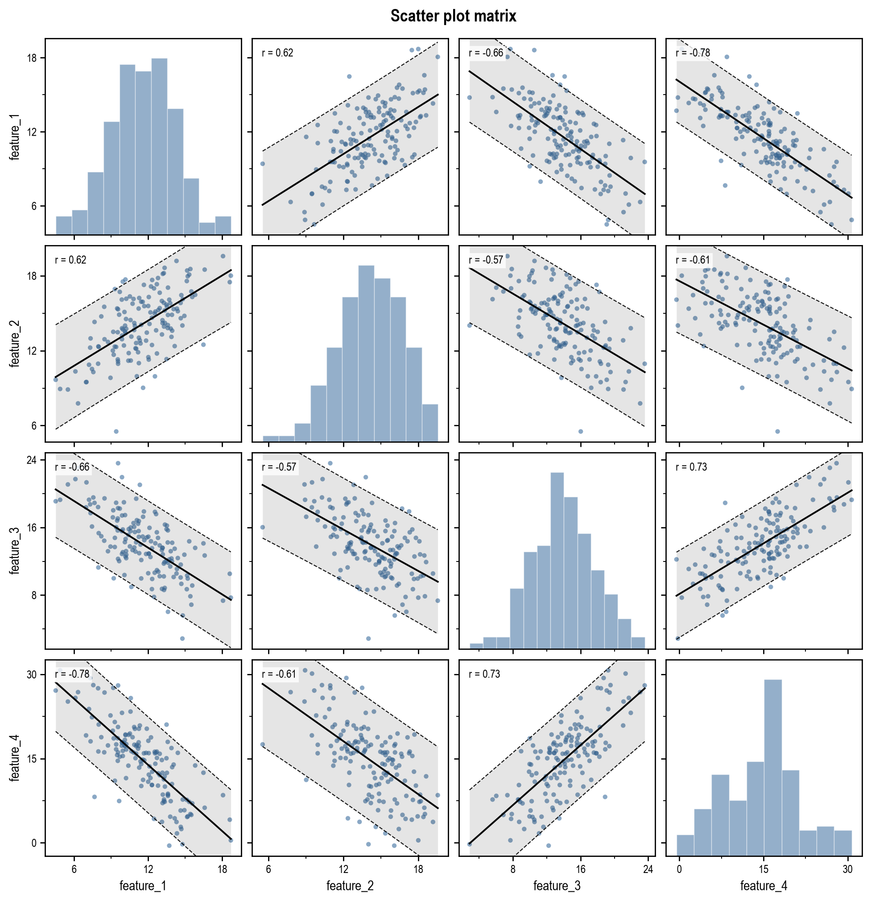

# scatterkit

A scatter plot matrix for N features — points, a regression line with standard-error
bands, a statistics note per panel, and a histogram / density on the diagonal — where
every visual choice is one `param=value` line in a config. The font is the single
exception: it is always Arial Narrow.



## Run

```bash
python -m scatterkit
```

```bash
python -m scatterkit --config=examples/titanic.txt
```

With no arguments it draws the defaults on built-in demo data and writes
`scatter_plot.png`. `--set param=value` overrides one parameter on top of the config
and can be repeated. Paths (`data_path`, `output_path`) are relative to the directory
you run from.

## Where the design lives

| file | what it is |
| --- | --- |
| [src/scatterkit/defaults.py](src/scatterkit/defaults.py) | **every default**, one line per parameter, grouped by section. Edit here to change what a bare run looks like. `FONT_FAMILY` is at the top. |
| [config.example.txt](config.example.txt) | the same list as a ready config: every parameter with its default, kind and a one-line description. Copy it, keep the lines you want to change. |

Regenerate the example after editing the defaults:

```bash
python -m scatterkit --dump-config=config.example.txt
```

## Config format

```
# comment
data_path=../Titanic-Dataset.xls
features=Age,Fare,SibSp
regression_is_shown=false            # *_is_shown and *_shown are the same key
regression_line_predict_bands=-1,2
points_color=#3C6E9F
figure_width=auto
```

- one `param=value` per line; blank lines and `#` comments are ignored
- booleans: `true/false`, `yes/no`, `on/off`, `1/0`
- lists are comma-separated; line styles are `-`, `--`, `-.`, `:` or a dash pattern `4,2`
- `auto` is accepted wherever the description says so; `\n` breaks a line in text values
- an unknown key or a bad value stops the run with the file, the line and a suggestion

## Sections

| section | prefix |
| --- | --- |
| data, output | `data_*`, `features`, `hue_*`, `output_*` |
| geometry (inches) | `figure_*`, `panel_*`, `matrix_part`, `diagonal_shown` |
| points | `points_*` |
| regression line and bands | `regression_*`, `regression_line_*`, `regression_line_predict_bands_*` |
| statistics note | `annotation_*` |
| diagonal | `diagonal_*` |
| box borders | `spine_*` |
| ticks, big and little | `ticks_{x,y}_{major,minor}_*` |
| numbers and names on the axes | `tick_labels_*`, `axis_labels_*` |
| grid, title, legend | `grid_*`, `title_*`, `legend_*` |

`regression_line_predict_bands` lists band edges in standard errors around the fit:
`-1,2` draws one edge 1 SE below and one 2 SE above. `regression_line_predict_bands_kind`
picks which standard error — `prediction`, `confidence` or `residual`.

`matrix_part=lower` with `diagonal_shown=false` on two features gives a single
ordinary scatter plot.

## From Python

```python
from scatterkit import Style, load_config, plot_scatter_matrix

result = plot_scatter_matrix(df, Style(features=["Age", "Fare"], points_alpha=0.3))
result = plot_scatter_matrix(df, load_config("config.txt"))
result.savefig("out.png")      # .figure, .axes, .stats (r, p, rho, r2, slope, intercept, n per panel)
```

## Install and tests

```bash
pip install -e .
```

```bash
python -m pytest
```
